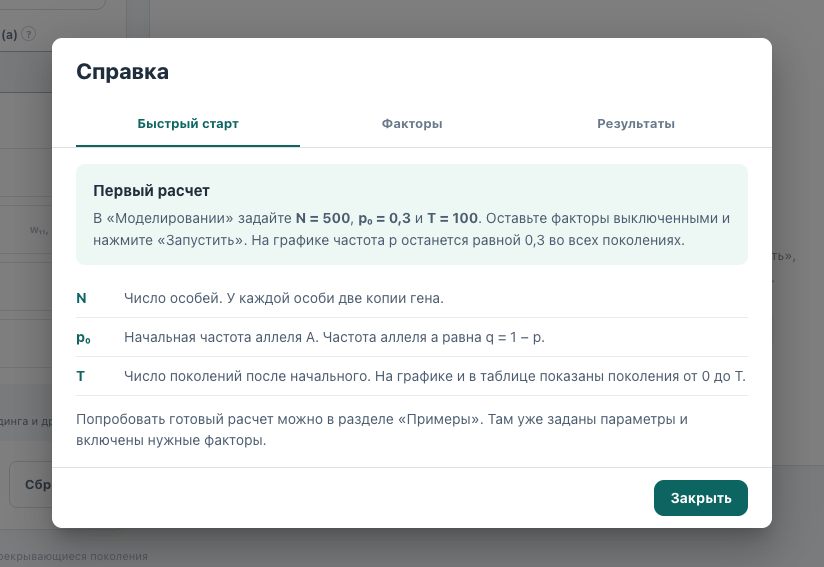
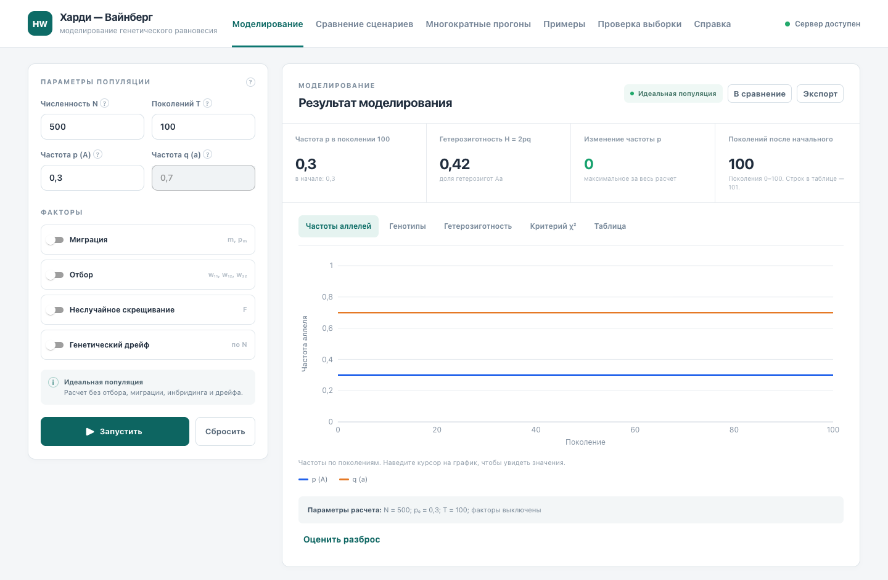
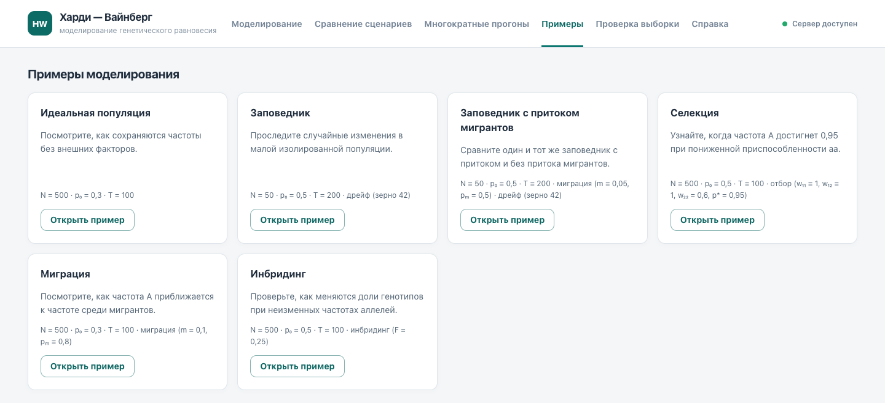
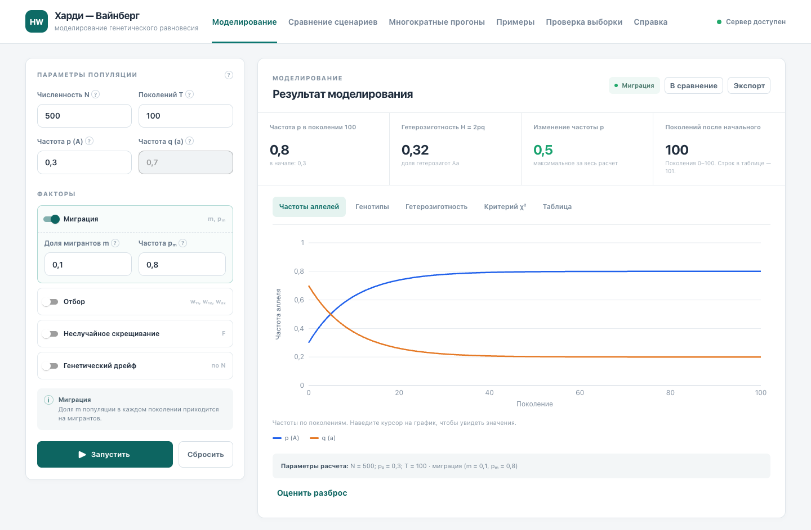
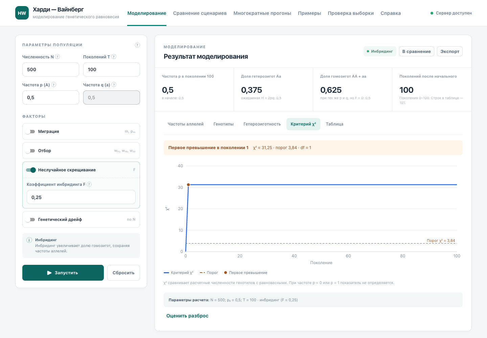
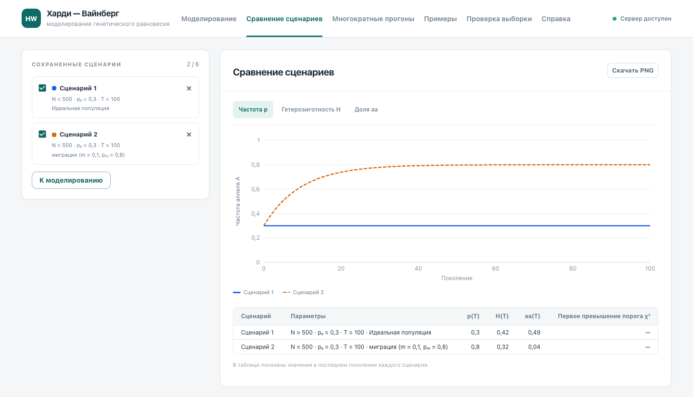
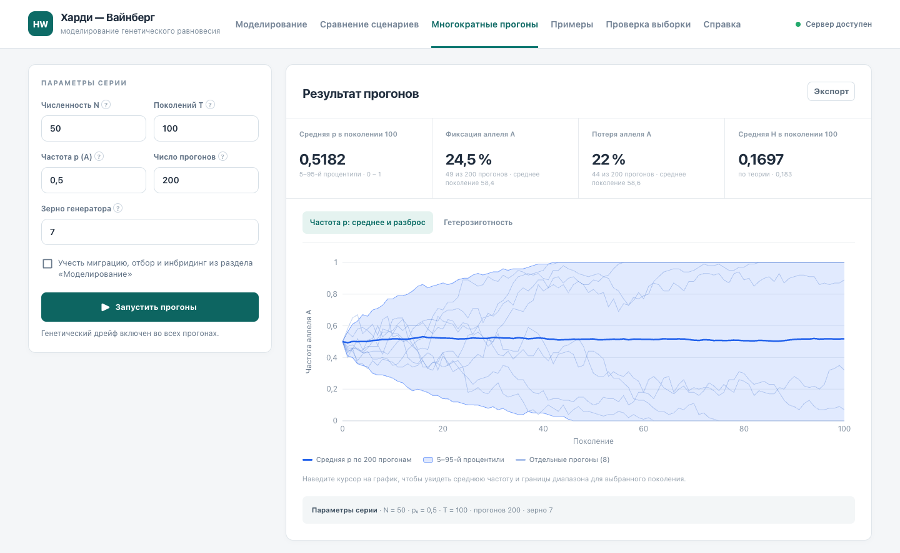
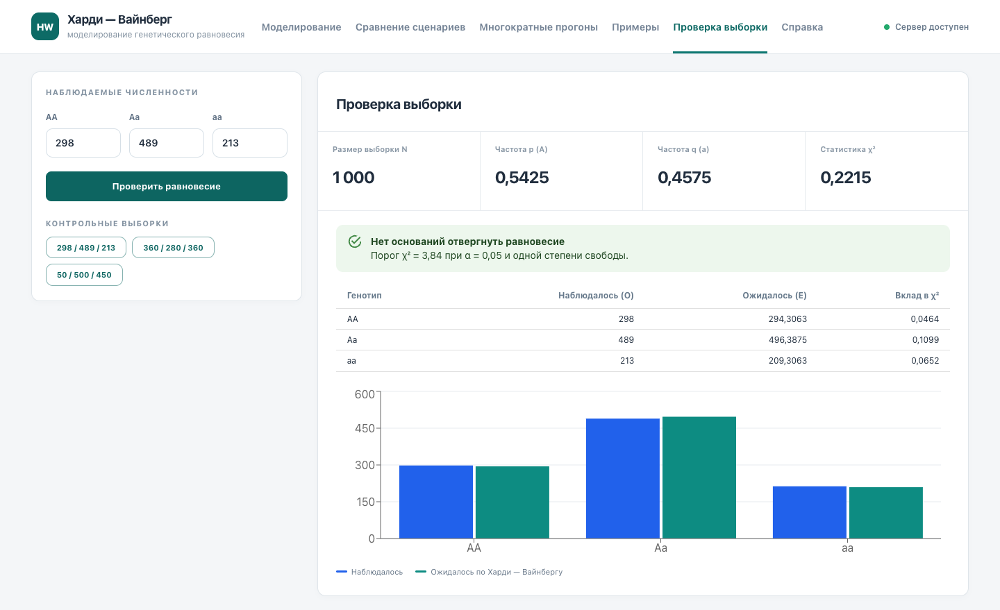
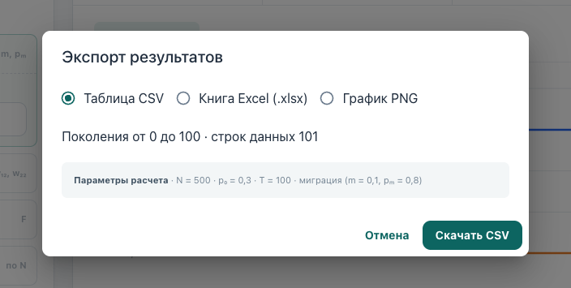

# Руководство пользователя симулятора Харди — Вайнберга

В симуляторе можно проследить, как по поколениям меняются частоты аллелей `A` и `a` и доли генотипов `AA`, `Aa` и `aa`. Начните с идеальной популяции, затем измените один фактор и сравните результаты. Для повторных случайных расчётов используйте раздел **«Многократные прогоны»**, а для собственных наблюдений откройте **«Проверка выборки»**.

- [Открытие симулятора](#открытие-симулятора)
- [Предметная область](#предметная-область)
- [Окно справки](#окно-справки)
- [Первый расчёт](#первый-расчёт)
- [Готовые примеры и факторы](#готовые-примеры-и-факторы)
- [Сравнение сценариев](#сравнение-сценариев)
- [Многократные прогоны](#многократные-прогоны)
- [Проверка выборки](#проверка-выборки)
- [Сохранение результатов](#сохранение-результатов)
- [Математическая модель](#математическая-модель)
- [Проблемы при работе](#проблемы-при-работе)

## Открытие симулятора

Откройте в браузере адрес симулятора. Когда справа вверху появится статус **«Сервер доступен»**, можно выполнять расчёты. Для самостоятельного запуска воспользуйтесь [руководством разработчика](developer-guide.md#запуск-через-docker-compose).

## Предметная область

Симулятор рассматривает одно место в геноме, **локус**, с двумя вариантами гена, **аллелями** $A$ и $a$. У каждой диплоидной особи две копии этого локуса, поэтому возможны три **генотипа** $AA$, $Aa$ и $aa$. В популяции из $N$ особей всего $2N$ копий.

**Частота аллеля** — доля его копий среди всех $2N$ копий. Частоты $A$ и $a$ обозначаются $p$ и $q$ и в сумме дают единицу. **Доля генотипа** — доля особей с данным сочетанием аллелей среди всех $N$ особей. Например, особь с генотипом $Aa$ даёт одну копию $A$ и одну копию $a$ при подсчёте частот.

Закон Харди — Вайнберга задаёт ожидаемые доли генотипов при случайном скрещивании. Если частоты аллелей равны $p$ и $q$, ожидаются доли $p^2$ для $AA$, $2pq$ для $Aa$ и $q^2$ для $aa$. В идеальной популяции частоты сохраняются из поколения в поколение при отсутствии отбора, миграции, мутаций и случайных изменений частот. В симуляторе этот случай соответствует отключённым факторам. [Г. Х. Харди, «Менделевские пропорции в смешанной популяции»](https://doi.org/10.1126/science.28.706.49)

Равновесные пропорции дают точку отсчёта при чтении графиков. Например, при миграции частота $p$ меняется, а пропорции генотипов в каждом поколении рассчитываются по новому $p$. При одном инбридинге наблюдается другой результат. Частота $p$ сохраняется, а доля гетерозигот уменьшается. Формулы и порядок применения факторов приведены в разделе [«Математическая модель»](#математическая-модель).

## Окно справки

Нажмите **«Справка»** в верхнем меню. Окно откроется поверх текущего раздела. Выберите вкладку, в которой есть нужное пояснение.

- **«Быстрый старт»** — параметры первого расчёта и значения обозначений `N`, `p₀` и `T`.
- **«Факторы»** — пояснения о миграции, отборе, неслучайном скрещивании и генетическом дрейфе.
- **«Результаты»** — как читать частоты, доли генотипов, гетерозиготность, χ² и разброс в серии прогонов. Здесь же указано, где сравнить и сохранить результаты.

Чтобы вернуться к работе, нажмите **«Закрыть»** в правом нижнем углу окна.

## Первый расчёт

1. Откройте раздел **«Моделирование»**.
2. Установите параметры по таблице. Поле **«Частота q (a)»** заполнится автоматически.

   | Поле | Значение для примера | Что означает |
   | --- | ---: | --- |
   | Численность N | 500 | Число диплоидных особей, от 2 до 100 000. |
   | Поколений T | 100 | Число поколений после начального, от 1 до 1000. |
   | Частота p (A) | 0,3 | Начальная доля копий аллеля `A`, от 0 до 1. |
   | Частота q (a) | 0,7 | Начальная доля копий аллеля `a`, равная `1 − p`. |

3. Оставьте четыре переключателя в блоке **«Факторы»** выключенными и нажмите **«Запустить»**.
4. Посмотрите вкладку **«Частоты аллелей»**. В идеальной популяции `p` остаётся равной 0,3, а `q` — 0,7. Обе линии горизонтальные.

*Слева находятся параметры и кнопка запуска. Справа показаны итоговые показатели и частоты по поколениям.*

Сводка над графиком показывает, в частности, частоту `p` в последнем поколении и наибольшее отклонение `p` от начальной частоты за весь расчёт. Чтобы узнать значение в конкретном поколении, наведите курсор на график или найдите строку на вкладке **«Таблица»**. Для 100 поколений в таблице будет 101 строка, включая начальное поколение 0.

| Вкладка | Что показывает |
| --- | --- |
| **Частоты аллелей** | Доли копий `A` и `a` по поколениям. |
| **Генотипы** | Доли особей `AA`, `Aa` и `aa`. При `p = 0,3` в идеальной популяции это 0,09, 0,42 и 0,49. |
| **Гетерозиготность** | Ожидаемую гетерозиготность `H = 2pq`. При включённом инбридинге отдельно показана модельная доля `Aa` с поправкой на `F`. |
| **Критерий χ²** | Отклонение модельных долей генотипов от равновесных пропорций при тех же `p` и `q`. |
| **Таблица** | Значения по поколениям, в том числе `p`, `q`, доли генотипов, `H` и χ², где он определён. |

После изменения полей нажмите **«Запустить»** ещё раз. Пока видна надпись **«Параметры изменены»**, на экране показан предыдущий расчёт. Кнопка **«Сбросить»** возвращает исходные настройки формы и очищает текущий результат.

## Готовые примеры и факторы

В разделе **«Примеры»** есть шесть готовых сценариев. Нажмите **«Открыть пример»** на нужной карточке. Симулятор заполнит форму и сразу выполнит расчёт. После расчёта можно менять параметры вручную.

### Миграция пошагово

1. В разделе **«Моделирование»** введите `N = 500`, `p = 0,3` и `T = 100`.
2. Включите **«Миграция»** и задайте **«Доля мигрантов m»** = 0,1 и **«Частота pₘ»** = 0,8. Остальные факторы оставьте выключенными.
3. Нажмите **«Запустить»**. На графике частота `p` приближается к 0,8.
4. На вкладке **«Таблица»** проверьте первые три значения `p`. В поколении 0 это 0,3, в поколении 1 — 0,35, в поколении 2 — 0,395.

### Остальные факторы

| Фактор | Какие поля заполнить | Что смотреть после расчёта |
| --- | --- | --- |
| **Отбор** | Относительную приспособленность `w₁₁` для `AA`, `w₁₂` для `Aa` и `w₂₂` для `aa`, от 0 до 1. Задайте также целевую частоту `p*`, от 0 до 1. | В сводке видно первое поколение, в котором частота достигла цели, или сообщение **«Не достигнута»**. Например, при `N = 500`, `p = 0,3`, `T = 100`, весах 1, 1 и 0,6 и цели 0,95 результат — поколение 53. |
| **Неслучайное скрещивание** | Коэффициент инбридинга `F`, от 0 до 1. Например, задайте `p = 0,5` и `F = 0,25`. | С первого поколения доля `Aa` падает с 0,5 до 0,375, а доли `AA` и `aa` возрастают до 0,3125 каждая. При одном инбридинге частоты аллелей сохраняются. |
| **Генетический дрейф** | Зерно генератора — целое число от 0 до 4 294 967 295. Пустое поле позволяет симулятору выбрать его и показать после расчёта. | Частоты меняются случайно. При `p = 1` аллель `A` фиксируется, при `p = 0` теряется. Чтобы повторить ту же траекторию, используйте одинаковые настройки и зерно. |

Можно включить несколько факторов одновременно. Модель последовательно применяет миграцию, отбор и дрейф, затем рассчитывает доли генотипов с учётом `F`. Поколение 0 показывает исходное состояние. Если дрейф привёл к потере или фиксации аллеля, миграция может изменить граничную частоту в следующих поколениях.

### Как читать модельный χ²

Откройте пример **«Инбридинг»**, затем выберите вкладку **«Критерий χ²»**. При `N = 500`, `p = 0,5` и `F = 0,25` показатель равен 0 в начальном поколении и 31,25 в первом. Порог 3,84 впервые превышен в поколении 1. Когда в популяции остаётся один аллель, модельный χ² не определён.

Здесь χ² рассчитан по долям, полученным в модели. Для проверки наблюдаемых численностей используйте отдельный раздел [«Проверка выборки»](#проверка-выборки).

## Сравнение сценариев

1. Выполните [первый расчёт](#первый-расчёт) и нажмите **«В сравнение»** в верхней части результата.
2. Выполните [расчёт с миграцией](#миграция-пошагово) с теми же `N`, `p` и `T`. Снова нажмите **«В сравнение»**.
3. Откройте **«Сравнение сценариев»** в верхнем меню. Выберите **«Частота p»** и посмотрите, как линии расходятся от общего начального значения 0,3. Под графиком приведены значения в последнем поколении каждого сценария.
4. Переключитесь на **«Гетерозиготность H»** или **«Доля aa»**, чтобы сравнить другой показатель. Флажок рядом со сценарием скрывает его на графике, кнопка **×** удаляет его из списка.

В списке помещается до шести сценариев. Они сохраняются в текущей вкладке браузера при её обновлении. Чтобы сохранить сравнение как изображение, нажмите **«Скачать PNG»**. В файл попадут линии и параметры видимых сценариев.

## Многократные прогоны

Один прогон с дрейфом показывает одну случайную траекторию. Несколько прогонов с одинаковыми параметрами показывают, насколько сильно могут различаться траектории и как часто встречаются фиксация и потеря аллеля.

1. Откройте **«Многократные прогоны»**. Для первого примера задайте `N = 50`, `T = 100`, `p = 0,5`, **«Число прогонов»** = 200 и **«Зерно генератора»** = 7.
2. Оставьте флажок учёта дополнительных факторов снятым и нажмите **«Запустить прогоны»**. Дрейф включён во всех прогонах. Можно задать от 10 до 1000 прогонов.
3. На вкладке **«Частота p: среднее и разброс»** найдите среднюю частоту, коридор от 5-го до 95-го процентиля по поколениям и линии первых восьми прогонов. В верхней сводке показаны число и доля прогонов с фиксацией и потерей, а при наличии события — среднее поколение, когда оно впервые произошло.
4. Откройте вкладку **«Гетерозиготность»**. Для чистого дрейфа при ненулевой начальной гетерозиготности можно сравнить среднюю `H` серии с теоретической кривой.

Чтобы перенести параметры одиночного расчёта в серию, нажмите **«Оценить разброс»** под его графиком. Флажок в форме серии определяет, учитывать ли параметры миграции, отбора и инбридинга из раздела **«Моделирование»**.

## Проверка выборки

1. Откройте **«Проверка выборки»**. Введите наблюдаемое **число особей** для каждого генотипа. Допустимы целые неотрицательные числа, а общий размер выборки составляет от 1 до 100 000 особей.
2. Для примера введите `AA = 298`, `Aa = 489`, `aa = 213` или нажмите готовый вариант **«298 / 489 / 213»**.
3. Нажмите **«Проверить равновесие»**. Получится `p = 0,5425`, `q = 0,4575` и χ² ≈ 0,2215. Значение ниже порога 3,84, поэтому оснований отвергнуть равновесие Харди — Вайнберга по этой проверке нет.
4. Сопоставьте наблюдаемые и ожидаемые численности в таблице и на диаграмме. Столбец вклада в χ² показывает, насколько каждый генотип повлиял на итоговую статистику.

Если в выборке представлен только один аллель или ожидаемая численность хотя бы одного генотипа меньше 5, результат объяснит, почему по χ² в этом случае нельзя сделать вывод о равновесии.

## Сохранение результатов

1. Выполните одиночный расчёт или серию прогонов и нажмите **«Экспорт»** над результатом.
2. Выберите формат для своей задачи.

   | Формат | Что сохраняется |
   | --- | --- |
   | **Таблица CSV** | Все поколения от 0 до `T`. Разделитель столбцов — запятая, десятичный разделитель — точка. |
   | **Книга Excel (.xlsx)** | Таблица всех поколений с фильтрами и отдельный лист с параметрами расчёта. |
   | **График PNG** | Текущий график с осями, легендой и параметрами расчёта. Для выбора PNG сначала откройте вкладку с графиком. |

3. Нажмите **«Скачать CSV»**, **«Скачать XLSX»** или **«Скачать PNG»**. Файл появится в папке загрузок или в папке, которую вы укажете в браузере.

## Математическая модель

В одном расчёте численность $N$ постоянна, локус один, поколения дискретны и не перекрываются. При заданных $p_0$ и $T$ симулятор рассчитывает состояния от $t=0$ до $t=T$. Начальное поколение всегда формируется по равновесным пропорциям. В следующих поколениях включённые факторы применяются в порядке **миграция → отбор → генетический дрейф → формирование генотипов с учётом инбридинга**.

### Равновесные пропорции и гетерозиготность

При случайном скрещивании две копии аллеля выбираются независимо из общего пула. Две копии $A$ встречаются с вероятностью $p\cdot p$, две копии $a$ — с вероятностью $q\cdot q$. Генотип $Aa$ получается в двух порядках, поэтому его вероятность равна $pq+qp$.

$$
q = 1-p,\qquad
f_{AA}=p^2,\qquad f_{Aa}=2pq,\qquad f_{aa}=q^2.
$$

Сумма трёх долей равна $(p+q)^2=1$. Из них можно восстановить исходную частоту $A$. Каждая особь $AA$ даёт две копии $A$, а $Aa$ — одну. Поэтому $p=f_{AA}+\tfrac12 f_{Aa}=p^2+pq$. Такое же рассуждение даёт $q=f_{aa}+\tfrac12 f_{Aa}$. При выключенных факторах это объясняет постоянство обеих частот.

**Ожидаемая гетерозиготность** $H=2pq$ — вероятность, что две независимо выбранные копии различаются. При $p=0{,}3$ получаем $H=0{,}42$. Максимум $H=0{,}5$ достигается при $p=q=0{,}5$.

### Миграция

Доля $m$ копий в новом смешанном пуле приходится на мигрантов с частотой $p_m$. Остальная доля $1-m$ приходится на местную популяцию.

$$
p_{\mathrm{mig}}=(1-m)p+m p_m.
$$

В примере с $p=0{,}3$, $m=0{,}1$ и $p_m=0{,}8$ первый шаг даёт $0{,}9\cdot0{,}3+0{,}1\cdot0{,}8=0{,}35$. При одной миграции разница $p_t-p_m$ на каждом шаге умножается на $1-m$. Поэтому при постоянных параметрах $p_t=p_m+(p_0-p_m)(1-m)^t$ для $t\geq1$. При $m=0$ частота сохраняется, при $m=1$ уже на первом шаге она равна $p_m$.

### Отбор

На вход отбора поступает частота $p$ после миграции или частота предыдущего поколения, если миграция выключена. Симулятор вычисляет для этой частоты равновесные доли $p^2$, $2pq$ и $q^2$ и умножает их на приспособленности $w_{11}$, $w_{12}$ и $w_{22}$ соответственно. Сумма взвешенных долей даёт среднюю приспособленность $\bar w$.

$$
\bar w=p^2w_{11}+2pqw_{12}+q^2w_{22},
\qquad
p_{\mathrm{sel}}=\frac{p^2w_{11}+pqw_{12}}{\bar w}.
$$

В числителе весь вклад $AA$ и половина взвешенного вклада $Aa$. При одинаковых положительных приспособленностях частота не меняется. При $\bar w=0$ долю $A$ после отбора вычислить невозможно. В сочетании с дрейфом уже достигнутая в предыдущем поколении граничная частота $0$ или $1$ при этом сохраняется, пока миграция её не изменила.

Например, при $p=0{,}3$ и весах $1$, $1$ и $0{,}6$ средняя приспособленность равна $0{,}804$, а частота после первого шага — примерно $0{,}3731$. Цель $p^*$ служит отметкой на графике. Если $p^*>p_0$, отмечается первое поколение с $p_t\geq p^*$. Для цели ниже $p_0$ ищется первое $p_t\leq p^*$. Совпадение с $p_0$ даёт поколение 0.

### Генетический дрейф

После миграции и отбора обозначим полученную частоту через $\tilde p$. При включённом дрейфе симулятор случайно выбирает $2N$ копий. Число копий $A$ в новом поколении имеет биномиальное распределение.

$$
X_t\sim\operatorname{Binomial}(2N,\tilde p),\qquad
p_t=\frac{X_t}{2N},\qquad
\operatorname{Var}(p_t\mid\tilde p)=\frac{\tilde p(1-\tilde p)}{2N}.
$$

Например, если при $N=100$ в выборку попало 103 копии $A$, то $p_t=103/200=0{,}515$. Среднее $p_t$ по таким выборкам равно $\tilde p$, а разброс больше при малом $N$. При $X_t=0$ фиксируется потеря $A$, при $X_t=2N$ — его фиксация. Симулятор отмечает первое такое поколение, включая поколение 0, если частота была граничной с самого начала.

При одном дрейфе, без других факторов, из биномиального разброса следует, что ожидаемая гетерозиготность после каждого шага в среднем умножается на $1-\tfrac{1}{2N}$. На вкладке **«Гетерозиготность»** для этого случая показана теоретическая кривая при $H_0>0$. Время, за которое она снижается вдвое, находится из равенства $\mathbb E[H_{t_{1/2}}]=H_0/2$.

$$
\mathbb E[H_t]=H_0\left(1-\frac{1}{2N}\right)^t,\qquad
t_{1/2}=\frac{\ln(1/2)}{\ln\left(1-\frac{1}{2N}\right)}.
$$

При $N=100$ получаем примерно 138,3 поколения. Теоретическая кривая описывает среднее по множеству прогонов. Отдельная траектория может временно отклоняться вверх или вниз.

### Инбридинг и состав генотипов

После определения итоговых $p$ и $q$ симулятор формирует доли генотипов. Коэффициент $F$ задаёт, какая доля от ожидаемых $2pq$ гетерозигот перераспределяется поровну между двумя гомозиготами.

$$
f_{AA}=p^2+Fpq,\qquad
f_{Aa}=2pq(1-F),\qquad
f_{aa}=q^2+Fpq.
$$

Сумма долей равна единице, а $f_{AA}+\tfrac12 f_{Aa}=p$. Поэтому $F$ изменяет доли генотипов, сохраняя частоты аллелей. При $F=0$ получаются равновесные пропорции, а при $F=1$ доля $Aa$ равна нулю. В результатах $H=2pq$ остаётся ожидаемым значением, а модельная доля $Aa$ показана отдельно.

В этой модели поправка на $F$ применяется только при формировании генотипов строки. Следующее поколение получает частоту $p$ из предыдущей строки, а для следующего шага отбора равновесные доли снова вычисляются из текущей частоты.

### Статистика серии прогонов

Пусть $R$ — число прогонов, а $p_{r,t}$ — частота $A$ в прогоне $r$ и поколении $t$. Симулятор вычисляет среднюю частоту и среднюю гетерозиготность отдельно для каждого поколения.

$$
\bar p_t=\frac1R\sum_{r=1}^{R} p_{r,t},
\qquad
\bar H_t=\frac1R\sum_{r=1}^{R} 2p_{r,t}(1-p_{r,t}).
$$

Сначала вычисляется $H$ каждого прогона, затем берётся среднее. Например, если половина прогонов завершилась при $p=0$, а половина при $p=1$, средняя частота равна $0{,}5$, но средняя $H$ равна нулю. При включённом инбридинге аналогично усредняется модельная доля $Aa$.

Нижняя и верхняя границы полосы — 5-й и 95-й процентили частот $p_{r,t}$ в данном поколении. Симулятор сортирует $R$ значений и использует линейную интерполяцию между соседними значениями, если позиция процентиля дробная. Положение для доли $u$ от 0 до 1 равно $(R-1)u$ при нумерации с нуля. Для фиксации и потери доля считается от всех $R$ прогонов, а среднее поколение события — по прогонам, где это событие было первым граничным.

### Критерий χ² Пирсона

Ожидаемые численности $E_g$ для каждого генотипа $g$ — это размер популяции или выборки, умноженный на $p^2$, $2pq$ или $q^2$. Статистика складывается из вкладов трёх генотипов.

$$
\chi^2=\sum_{g\in\{AA,Aa,aa\}}\frac{(O_g-E_g)^2}{E_g}.
$$

- В **«Моделировании»** величины $O_g=Nf_g$ — расчётные численности, а $E_g$ — равновесные ожидания при тех же $p$ и $q$. Симулятор использует их без округления и отмечает первое значение строго выше 3,84. При двух аллелях и поправке на инбридинг подстановка трёх долей даёт $\chi^2=NF^2$. Например, при $N=500$ и $F=0{,}25$ получаем $31{,}25$. Это показатель отклонения внутри моделирования.
- В **«Проверке выборки»** $O_{AA}$, $O_{Aa}$ и $O_{aa}$ — введённые наблюдения. Сначала суммируются особи ($n=O_{AA}+O_{Aa}+O_{aa}$), затем подсчитываются копии аллелей.

$$
p=\frac{2O_{AA}+O_{Aa}}{2n},\qquad
q=\frac{2O_{aa}+O_{Aa}}{2n}.
$$

Для выборки $298$, $489$, $213$ ожидаемые численности составляют примерно $294{,}3063$, $496{,}3875$ и $209{,}3063$. Вклады дают в сумме около $0{,}2215$. У трёх численностей зафиксирована сумма, и одна частота оценивается по той же выборке. Поэтому остаётся $3-1-1=1$ степень свободы. На уровне значимости $0{,}05$ симулятор использует порог 3,84. Выше порога он сообщает о значимом отклонении, при значении до порога включительно — об отсутствии оснований отвергнуть равновесие.

Если присутствует один аллель, часть $E_g$ равна нулю и статистика не определяется. Если присутствуют оба аллеля, но хотя бы одна ожидаемая численность меньше 5, приложение показывает рассчитанное значение без вывода о значимости. Для малых ожидаемых численностей применимость приближения χ² ограничена. [Wigginton, Cutler, Abecasis, «A Note on Exact Tests of Hardy-Weinberg Equilibrium»](https://pubmed.ncbi.nlm.nih.gov/15789306/)

## Проблемы при работе

| Что видно на экране | Что сделать |
| --- | --- |
| Страница не открывается | Проверьте адрес, включая номер порта, если он указан. Если проблема сохраняется, уточните адрес у того, кто предоставил ссылку. |
| Вверху написано **«Сервер недоступен»** | Обновите страницу и повторите расчёт. Если статус сохраняется, сообщите об этом тому, кто запустил симулятор. |
| Поле подсвечено и под ним есть сообщение | Исправьте указанное значение. Частоты и коэффициенты задаются от 0 до 1, а численность, число поколений и число прогонов — целыми числами. Дроби можно вводить и с запятой, и с точкой. |
| Рядом с результатом написано **«Параметры изменены»** | Нажмите **«Запустить»** или **«Запустить прогоны»**. |
| В сравнении нет линии сценария | Поставьте флажок рядом с нужным сценарием в списке слева. |
| В окне экспорта недоступен **«График PNG»** | Закройте окно экспорта, откройте вкладку с графиком и снова нажмите **«Экспорт»**. |

Чтобы увидеть пояснение к полю, наведите курсор на значок **?** рядом с ним.
